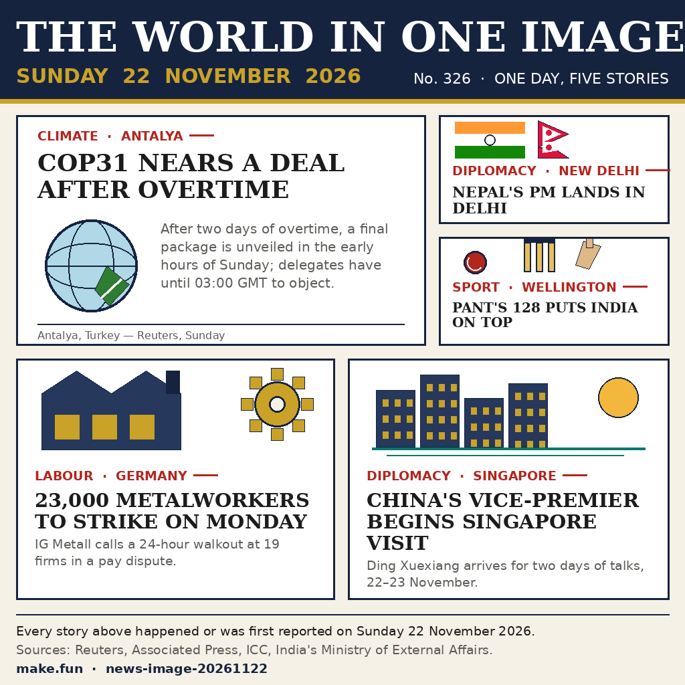

# The World in One Image — Sunday 22 November 2026

[](https://make.fun/bounty/news-image-20261122?utm_source=github&utm_medium=readme&utm_campaign=news-image-20261122)
[](https://make.fun/bounty/news-image-20261122/leaderboard?utm_source=github&utm_medium=readme&utm_campaign=news-image-20261122)
[](https://make.fun/bounty/news-image-20261122?utm_source=github&utm_medium=readme&utm_campaign=news-image-20261122)

A one-image summary of the world's news of **Sunday 22 November 2026**,
drawn as a newspaper front page: five stories, each with a pictogram, a
headline and a short deck.



## The five stories

1. **Climate · Antalya** — COP31 nears a final deal after two days of
   overtime: presidents unveil a new package in the early hours of Sunday,
   with an approval session set for 06:00 GMT.
2. **Diplomacy · New Delhi** — Nepal's prime minister Balendra Shah arrives
   in Delhi for his first state visit to India; talks with Narendra Modi
   follow on Monday.
3. **Sport · Wellington** — Rishabh Pant hits 128 as India reach 629/6 on
   day four of the first Test against New Zealand.
4. **Labour · Germany** — IG Metall calls a 24-hour strike for Monday,
   with 23,000 workers at 19 firms in northern Germany walking out in a
   pay dispute.
5. **Diplomacy · Singapore** — China's vice-premier Ding Xuexiang begins a
   two-day visit to Singapore.

Every story happened or was first reported on Sunday 22 November 2026.
Facts verified against reporting by Reuters, the Associated Press, the ICC
and India's Ministry of External Affairs on 22 November 2026.

## How to run it

`draw.py` renders the poster (Python 3 with Pillow and the system DejaVu
fonts, deterministic — no timestamps, no randomness, no network):

```sh
python3 draw.py   # writes entry.png, 1024x1024
```

`main.py` (Python 3.13, standard library only) copies the shipped
`entry.png` to the output directory:

```sh
mkdir -p out && MAKEFUN_OUTPUT_DIR=out python3 main.py
```

Running it twice produces byte-identical output.

## License

MIT — see [LICENSE](LICENSE).

---
Built for the [make.fun](https://make.fun/r/7nvvsk82) bounty
`news-image-20261122`. Try make.fun yourself:
https://make.fun/r/7nvvsk82
